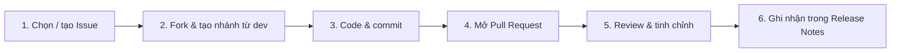

<div align="center">

# 🤝 Đóng góp cho EduPlay Studio

### Mọi đóng góp — dù là code, tài liệu hay một góp ý nhỏ — đều đáng trân trọng

<p>
  
  
  
</p>

[💡 Ý tưởng](https://github.com/Tan0807-creat3/EduPlay-Studio/issues) · [🐛 Báo lỗi](https://github.com/Tan0807-creat3/EduPlay-Studio/issues/new) · [⬅ Về README](README.md)

</div>

---

> **Tinh thần EduPlay:** Rõ ràng hơn hào nhoáng · Giá trị giáo dục là ưu tiên · Bền vững dài hạn.
>
> Mã nguồn được chia sẻ theo **PolyForm Noncommercial 1.0.0** — xem [`LICENSE`](LICENSE).
> Nhánh bạn gửi được xem là **đề xuất ý tưởng**; core team sẽ xem xét, tinh chỉnh và đưa vào bản chính thức theo định hướng chung.
> Tên bạn sẽ được ghi nhận trong **Contribution Notes** của bản phát hành kế tiếp & trang tri ân.

---

## 📑 Mục lục

- [🔗 Liên kết dự án](#-liên-kết-dự-án)
- [🌱 Cách bạn có thể đóng góp](#-cách-bạn-có-thể-đóng-góp)
- [🔄 Quy trình đóng góp](#-quy-trình-đóng-góp)
- [🌿 Quy ước nhánh](#-quy-ước-nhánh)
- [📝 Quy ước commit](#-quy-ước-commit)
- [🎨 Phong cách code](#-phong-cách-code)
- [🧪 Chạy test](#-chạy-test)
- [🌐 Ngôn ngữ](#-ngôn-ngữ)
- [✅ Checklist trước khi gửi PR](#-checklist-trước-khi-gửi-pr)

---

## 🔗 Liên kết dự án

| Kênh | Liên kết |
|:---|:---|
| **Repository** | `https://github.com/Tan0807-creat3/EduPlay-Studio` *(đặt URL đúng cho bản phân phối của bạn)* |
| **Issues** | [Mở issue mới](https://github.com/Tan0807-creat3/EduPlay-Studio/issues/new) |
| **Pull Requests** | [Danh sách PR](https://github.com/Tan0807-creat3/EduPlay-Studio/pulls) |

---

## 🌱 Cách bạn có thể đóng góp

### 👥 Không cần viết code

| Việc bạn có thể làm | Giá trị |
|:---|:---|
| Trả lời câu hỏi, tham gia thảo luận trong Issues | Giúp cộng đồng học hỏi lẫn nhau |
| Test lại bug trên máy mình & xác nhận | Giúp dev tái hiện lỗi nhanh |
| Đặt câu hỏi làm rõ cho issue mơ hồ | Làm spec rõ ràng hơn |
| Gợi ý từ ngữ, tên biến, luồng UX tốt hơn | Nâng trải nghiệm giáo viên/học sinh |
| Phản hồi dưới góc nhìn **người dạy / người học** | Giữ dự án đúng mục tiêu giáo dục |

> 💬 *Giao tiếp rõ ràng có giá trị như code sạch.*

### 💻 Đóng góp code

Bắt đầu nhỏ, tập trung. Gợi ý theo nhãn:

| Nhãn | Ý nghĩa | Link |
|:---|:---|:---|
| `good first issue` | Nhiệm vụ thân thiện cho người mới | [Xem](https://github.com/Tan0807-creat3/EduPlay-Studio/issues?q=is%3Aopen+label%3A%22good+first+issue%22) |
| `help wanted` | Cần trợ giúp | [Xem](https://github.com/Tan0807-creat3/EduPlay-Studio/issues?q=is%3Aopen+label%3A%22help+wanted%22) |
| `bug` | Sửa lỗi ưu tiên | [Xem](https://github.com/Tan0807-creat3/EduPlay-Studio/issues?q=is%3Aopen+label%3Abug) |
| `enhancement` | Tính năng & cải tiến lớn | [Xem](https://github.com/Tan0807-creat3/EduPlay-Studio/issues?q=is%3Aopen+label%3Aenhancement) |

---

## 🔄 Quy trình đóng góp



**Chi tiết:**

1. **Gắn với Issue** — mọi đóng góp nên liên kết tới một Issue (có sẵn hoặc tự tạo).
2. **Fork** repository → tạo nhánh mới từ `dev`.
3. **Code** theo phong cách của module bạn đụng tới.
4. **Commit** theo Conventional Commits (xem bên dưới).
5. **Mở PR** với mô tả rõ: *vấn đề gì — giải pháp gì — cách test*.
6. Chờ review. Core team có thể điều chỉnh để phù hợp định hướng.

> [!IMPORTANT]
> - Ưu tiên **dễ đọc** hơn **mẹo thông minh**.
> - Tránh thêm dependency không cần thiết.
> - Mọi thay đổi nên mang tính **giáo dục**.

---

## 🌿 Quy ước nhánh

### Nhánh lâu dài

| Nhánh | Vai trò |
|:---|:---|
| `main` | Ổn định, sẵn sàng phát hành |
| `dev` | Nhánh phát triển chính |
| `test` | Kiểm thử trước khi merge vào `main` |

### Nhánh tạm thời

| Tiền tố | Dùng cho | Ví dụ |
|:---|:---|:---|
| `feature/` | Tính năng mới | `feature/interactive-quiz` |
| `bugfix/` | Sửa lỗi thường | `bugfix/score-calculation` |
| `hotfix/` | Sửa gấp | `hotfix/crash-on-export` |
| `docs/` | Chỉ sửa tài liệu | `docs/setup-guide` |
| `experimental/` | Thử ý tưởng | `experimental/ai-hint-v2` |
| `wip/` | Đang làm dở | `wip/editor-undo` |
| `merging/` | Giải quyết conflict | `merging/dev-into-feature` |

**Quy tắc đặt tên:**

- Dùng `/` hoặc `-` làm dấu phân cách
- Bắt đầu bằng danh mục (`feature`, `bugfix`, ...)
- Tránh tên chỉ gồm số
- Ngắn gọn, mô tả rõ

---

## 📝 Quy ước commit

Tuân theo **[Conventional Commits](https://www.conventionalcommits.org/)**.

| Type | Ý nghĩa |
|:---|:---|
| `feat:` | Tính năng mới |
| `fix:` | Sửa lỗi |
| `docs:` | Tài liệu |
| `style:` | Format, không đổi logic |
| `refactor:` | Tái cấu trúc |
| `perf:` | Hiệu năng |
| `test:` | Thêm/sửa test |
| `chore:` | Bảo trì |
| `ci:` | CI/CD |
| `build:` | Hệ thống build / phụ thuộc |

**Quy tắc:**

- Message **viết thường** (lowercase)
- Breaking change: thêm `!` hoặc footer `BREAKING CHANGE:`

```bash
feat(game): add interactive quiz mode
fix(ui): prevent button overlap on small screens
docs(readme): improve installation steps
```

---

## 🎨 Phong cách code

> *Kho này không chỉ là phần mềm — nó còn là **tài liệu học tập**.*

**Ưu tiên:**

- 📖 **Dễ đọc** — tên biến/hàm có nghĩa, luồng rõ ràng
- 🪶 **Đơn giản** — tránh lồng nhau sâu, tránh shortcut khó hiểu
- 💬 **Có chú thích** cho logic không hiển nhiên
- 🧩 **Hàm & file nhỏ** — mỗi đơn vị làm một việc

Theo đúng phong cách của module bạn đang sửa. Khi phân vân, hãy chọn cách **rõ ràng nhất**.

---

## 🧪 Chạy test

Không dùng `pytest` — repo dùng `unittest` của thư viện chuẩn.

```powershell
cd eduplay_studio

# Toàn bộ suite
python -m unittest discover -s tests -t tests -p "test_*.py"

# Một nhóm liên quan
python -m unittest tests.test_crash_safety tests.test_session6_features
```

| Nhóm test | Phủ cái gì |
|:---|:---|
| `test_crash_safety.py` | Lưới bắt lỗi Qt, log crash, splash Tk an toàn khi thoát |
| `test_help_truthfulness.py` | Hướng dẫn trong app phải khớp code (phím tắt, nút, định dạng nhập) |
| `test_session6_features.py` | Hộp thoại Trợ giúp, link, undo/redo |
| `test_export_css_balance.py` | Cân bằng `{}` trong QSS |

> ⚠️ Nếu bạn đổi nhãn nút, phím tắt, định dạng nhập/xuất hoặc thời hạn link →
> `test_help_truthfulness.py` sẽ **fail**. Đó là chủ ý: sửa cả tài liệu và code cho khớp.

## 🌐 Ngôn ngữ

Mọi chuỗi hiển thị phải có đủ **5 ngôn ngữ**: `vi`, `en`, `fr`, `es`, `de`
(`eduplay_studio/eduplay/resources/i18n/*.json`).

Nội dung Trợ giúp nằm trong key `help.sections.*.content` dạng HTML. Quy tắc khi viết:

- **Không hardcode màu** — dùng token `{{fg}}`, `{{muted}}`, `{{surface_ok}}`,
  `{{accent}}`… Runtime sẽ thay bằng màu đúng theo theme sáng/tối.
- **Không dùng emoji hiếm** — chỉ dùng emoji có sẵn trong Segoe UI Emoji trên Windows,
  nếu không sẽ hiện ô vuông (vd `🛟` U+1F6DF đã từng hỏng).
- Không viết tiêu đề rỗng kiểu *"Phần 1 — Giới thiệu"* — hướng dẫn phải như tài liệu,
  không như log thay đổi.

Sau khi sửa nội dung hàng loạt, chạy lại script:

```powershell
python eduplay_studio\scripts\fix_help_accuracy.py     # sửa tuyên bố sai theo code
python eduplay_studio\scripts\refresh_help_content.py  # dọn boilerplate + token màu
```

---

## ✅ Checklist trước khi gửi PR

- [ ] Đã liên kết Issue
- [ ] Nhánh tạo từ `dev`, đặt tên đúng quy tắc
- [ ] Commit theo Conventional Commits, viết thường
- [ ] Đã chạy `python -m unittest discover -s tests -t tests -p "test_*.py"` và tất cả pass
- [ ] Chuỗi mới có đủ 5 ngôn ngữ
- [ ] Nếu đụng tới nhãn/phím tắt/tính năng: cập nhật cả i18n và `README.md`/`INSTALLATION.md`
- [ ] Tự test thủ công (chạy `python eduplay_studio/app.py`)
- [ ] Không thêm dependency thừa
- [ ] Cập nhật tài liệu nếu thay đổi UX/API
- [ ] Mô tả PR rõ: *vì sao — làm gì — test thế nào*

---

<div align="center">

### Cảm ơn bạn đã cùng xây EduPlay Studio 💙

*Người mới? Đây là nơi an toàn để bắt đầu.*
*Đã có kinh nghiệm? Sự dẫn dắt của bạn rất quý giá.*
*Yêu giáo dục? Đóng góp của bạn tạo khác biệt.*

[⬆ Lên đầu trang](#-đóng-góp-cho-eduplay-studio)

</div>
