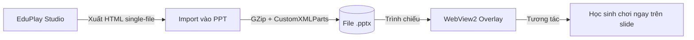

<div align="center">

# 🎮 EduPlay Studio

### Nền tảng tạo game học tập · AI-powered · Offline-first

<p>
  
  
  
  
</p>

<p>
  <a href="https://github.com/Tan0807-creat3/EduPlay-Studio"></a>
  <a href="INSTALLATION.md"></a>
  <a href="SECURITY.md"></a>
</p>

> *Biến ý tưởng dạy học thành game tương tác chỉ trong vài phút — không cần biết code.*

[🚀 Bắt đầu ngay](#-cai-dat-nhanh) · [📖 Hướng dẫn](#-tai-lieu) · [🗺️ Lộ trình](ROADMAP.md) · [💬 Đóng góp](CONTRIBUTING.md)

</div>

---

## ✨ Vì sao chọn EduPlay Studio?

<table>
<tr>
<td width="33%" align="center">

### 🤖 AI Trợ giảng
**Edubot** tự sinh câu hỏi, đáp án & gợi ý qua máy chủ AI của EduPlay — không cần API key

</td>
<td width="33%" align="center">

### 🎨 Không cần code
Soạn theo mẫu sẵn · Xem trước tức thì · Xuất HTML5 hoặc link web

</td>
<td width="33%" align="center">

### 🔌 PowerPoint Native
Nhúng game trực tiếp vào slide, chạy offline với WebView2

</td>
</tr>
<tr>
<td align="center">

### 📦 Offline 100%
Game HTML5 tự chứa (single-file), chạy không cần mạng

</td>
<td align="center">

### 🧩 Mẫu đa dạng
Trắc nghiệm · Triệu phú · Bắt cá · Phiêu lưu · Platformer

</td>
<td align="center">

### 🪟 Windows tối ưu
Installer MSI + Inno Setup · Tự động cập nhật & gỡ sạch

</td>
</tr>
</table>

---

## 📑 Mục lục

- [✨ Vì sao chọn EduPlay Studio?](#-vi-sao-chon-eduplay-studio)
- [🖼️ Giao diện](#️-giao-dien)
- [⚡ Cài đặt nhanh](#-cai-dat-nhanh)
- [🧠 Kết nối AI (Edubot)](#-ket-noi-ai-edubot)
- [🔌 Tích hợp PowerPoint](#-tich-hop-powerpoint)
- [📤 Xuất bản](#-xuat-ban)
- [🏗️ Kiến trúc dự án](#️-kien-truc-du-an)
- [📖 Tài liệu](#-tai-lieu)
- [🤝 Đóng góp](#-dong-gop)
- [📄 Giấy phép](#-giay-phep)

---

## 🖼️ Giao diện

<div align="center">

| Studio — Trình chỉnh sửa | Xem trước (Preview) | PowerPoint Add-in |
|:---:|:---:|:---:|
| *Soạn câu hỏi, media, logic* | *Chạy thử game tức thì* | *Nút EduPlay trên Ribbon* |
| `eduplay_studio/` | `WebEngine Preview` | `VSTO / COM Add-in` |

> 💡 *Mẹo: Trong màn hình soạn, bấm **Xem trước** (nút xanh) để chơi thử cả bài; phím tắt xem trong app: `Ctrl+K` tìm nhanh, `Ctrl+Z` hoàn tác.*

</div>

---

## ⚡ Cài đặt nhanh

### Yêu cầu hệ thống

| Thành phần | Yêu cầu |
|:---|:---|
| **HĐH** | Windows 10 / 11 (64-bit, build ≥ 17763) |
| **Python** | 3.10+ (khuyến nghị 3.12) |
| **RAM / Ổ cứng** | ≥ 4 GB RAM · ≥ 1 GB trống |
| **PowerPoint** | 2016+ (đã kích hoạt) — tùy chọn, cho Add-in |
| **WebView2** | Evergreen Runtime — cho COM Add-in |

### ▶️ Cách 1: Chạy từ mã nguồn (dành cho dev)

```powershell
# 1. Tạo môi trường ảo
python -m venv venv
.\venv\Scripts\Activate.ps1

# 2. Cài phụ thuộc
pip install -r requirements.txt

# 3. Chạy (không cần cấu hình gì thêm)
python eduplay_studio\app.py
```

> [!TIP]
> Dùng `requirements.lock` nếu muốn phiên bản phụ thuộc khóa chặt chẽ.

### 📦 Cách 2: Bộ cài Windows (người dùng cuối)

```powershell
# Build bản portable
.\build_release.bat        # → dist\EduPlayStudio\EduPlayStudio.exe

# Đóng gói installer
.\build_installer.bat      # → installer\EduPlay-Studio-v1.0.0-Setup.exe
```

Chi tiết xem [**INSTALLATION.md**](INSTALLATION.md).

---

## 🧠 Kết nối AI (Edubot)

**Không cần API key.** Edubot kết nối tới máy chủ AI của EduPlay và tự đăng ký
thiết bị theo máy (`device_id` / `device_key` / `machine_fingerprint`) nên mở app
lên là dùng được.

| Tên biến | Bắt buộc | Mặc định | Mô tả |
|:---|:---:|:---|:---|
| — | ❌ | `https://site--eduplay-ai--sx2zlgv27rbh.code.run` | Máy chủ AI (tự nhận diện) |
| `GROQ_MODEL` | — | `openai/gpt-oss-20b` | Ghi đè model khi cần |

```powershell
# Chỉ khi muốn đổi model
$env:GROQ_MODEL="openai/gpt-oss-20b"
```

Ngoài ra, trong **Cài đặt → AI** có thể bật *Cho phép truy cập Internet* (tìm nội dung)
và *Cho phép tải ảnh* (tự gắn ảnh vào câu hỏi).

> [!CAUTION]
> Key OpenAI/Gemini (nếu bạn tự nhập trong Cài đặt) được lưu cục bộ. **Không** commit lên git, và hãy che key khi gửi log/ảnh.

---

## 🔌 Tích hợp PowerPoint

<div align="center">



</div>

**Các bước:**

1. Mở **EduPlay Studio → Cài đặt → Add-in → Cài / Sửa Add-in**
2. Chấp nhận hộp thoại **UAC** (quyền Admin)
3. **Khởi động lại PowerPoint**
4. Trên Ribbon tìm tab **EduPlay** (hoặc `Add-ins` nếu Office gom nhóm)

<details>
<summary>🛠️ Gỡ rối Add-in không hiện?</summary>

- Kiểm tra Office đã **kích hoạt** (Office chưa active sẽ ẩn Add-in).
- Vào `Tệp → Tùy chọn → Add-ins → COM Add-ins → Đi...` xem `EduPlay` có được tick không.
- Với COM Add-in cần **WebView2 Runtime Evergreen** đã cài.
- Chạy lại `Cài / Sửa Add-in` trong Studio với quyền Admin.

</details>

Tài liệu chi tiết: [`ppt_vsto_addin/README.md`](ppt_vsto_addin/README.md) · [`ppt_com_addin/README.md`](ppt_com_addin/README.md)

---

## 📤 Xuất bản

| Định dạng | Mô tả | Chạy ở đâu |
|:---|:---|:---|
| **🌐 HTML5 (nút cam)** | Gói offline: 1 file `.html` chứa toàn bộ assets | Trình duyệt, Zalo/Email, USB, PowerPoint |
| **🔗 Link web (nút xanh)** | Xuất lên Firebase, nhận link chơi công khai (~15 ngày) | Trình duyệt, LMS — học sinh cần mạng |

> Tất cả tài nguyên (ảnh, âm thanh, font) được **bundle** — gửi 1 file là chạy.
> Xuất EXE/Native **chưa có nút trên giao diện**, nên tài liệu không hướng dẫn dùng.

---

## 🏗️ Kiến trúc dự án

```
EDUPLAY-OFFLINE/
├── eduplay_studio/          # Ứng dụng chính (PySide6)
│   ├── app.py               # Entry point
│   ├── eduplay/             # Core: editor, preview, export, AI
│   └── resources/           # Icons, templates, VSTO MSI
├── ppt_vsto_addin/          # VSTO Add-in (C#)
├── ppt_com_addin/           # COM Add-in x64 + WebView2
├── cloudflare_ai_proxy/     # Proxy AI (Cloudflare)
├── northflank_ai_gateway/   # Gateway AI (Northflank)
├── build_release.bat        # Build Nuitka + Cython
├── setup.iss                # Inno Setup installer
└── docs/                    # Tài liệu bổ sung
```

**Công nghệ chính:** `PySide6` · `Qt WebEngine` · `Nuitka + Cython` · `Inno Setup` · `VSTO / COM + WebView2` · Máy chủ AI tự đăng ký thiết bị (OpenAI-compatible)

---

## 📖 Tài liệu

| Tài liệu | Mô tả |
|:---|:---|
| [📥 INSTALLATION.md](INSTALLATION.md) | Hướng dẫn cài đặt & build chi tiết |
| [🗺️ ROADMAP.md](ROADMAP.md) | Lộ trình 1.1 → 2.0 |
| [🔒 SECURITY.md](SECURITY.md) | Chính sách bảo mật & báo lỗi |
| [📜 TERMS OF USE.md](TERMS%20OF%20USE.md) | Điều khoản sử dụng |
| [🙏 ACKNOWLEDGEMENTS.md](ACKNOWLEDGEMENTS.md) | Tri ân & nguồn cảm hứng |
| [📝 CHANGELOG.md](CHANGELOG.md) | Lịch sử phiên bản |

> 📖 Hướng dẫn sử dụng chi tiết nằm **trong app**: bấm nút **?** ở góc trên-phải (mục *Trợ giúp*), hoặc bấm `Ctrl+K` rồi gõ "trợ giúp".

---

## 🤝 Đóng góp

EduPlay là dự án giáo dục — mọi đóng góp (code, tài liệu, thiết kế, phản hồi) đều quý giá!

- Đọc [CONTRIBUTING.md](CONTRIBUTING.md) để nắm quy trình, quy ước nhánh & commit.
- Ý tưởng của bạn sẽ được ghi nhận trong **Contribution Notes** của bản phát hành kế tiếp.

> [!NOTE]
> Nhánh đóng góp được xem là *đề xuất ý tưởng* — core team sẽ xem xét & tinh chỉnh để phù hợp định hướng chung.

---

## 📄 Giấy phép

Dự án được cấp phép theo **PolyForm Noncommercial License 1.0.0** — xem [LICENSE](LICENSE).

- ✅ Dùng cho cá nhân, giáo dục, nghiên cứu, phi lợi nhuận
- ❌ Không dùng cho mục đích thương mại khi chưa có thỏa thuận

---

<div align="center">

**Được xây dựng với ❤️ cho giáo dục**

*Scratch · GDevelop · Wordwall · Kahoot — những nguồn cảm hứng lớn*

[⬆ Lên đầu trang](#-eduplay-studio)

</div>
